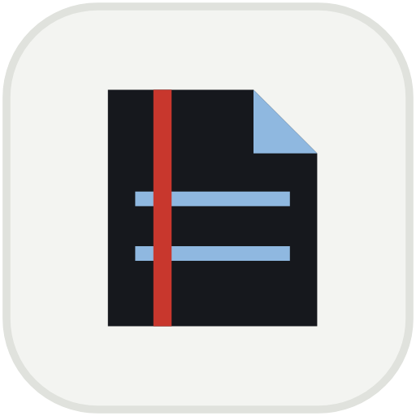
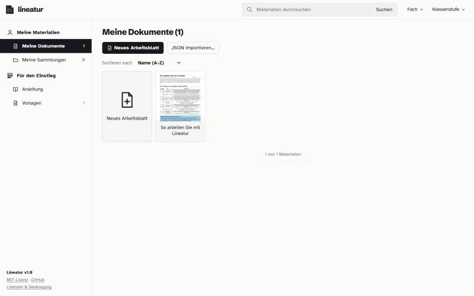
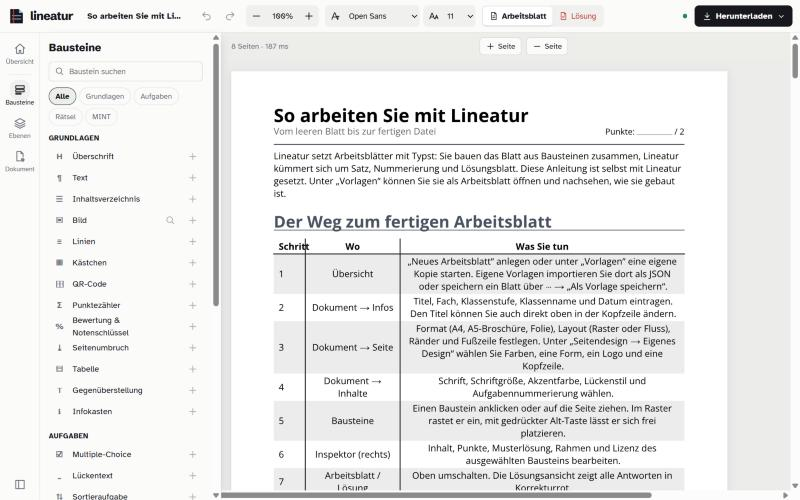

<div align="center">



# Lineatur

[](LICENSE)
[](package.json)
[](package.json)
[](https://typst.app)

</div>

Open-Source-Editor ohne Programmierkenntnisse für Arbeitsblätter, Klassenarbeiten und Broschüren.
Blockeditor im Browser → JSON-Dokument → Typst → PDF, Live-Vorschau oder interaktives HTML.
Änderungen sind in [CHANGELOG.md](CHANGELOG.md) dokumentiert.

**Inhalt:** [Vorschau](#vorschau) · [Desktop-App](#desktop-app) · [Browser-App](#installation) · [Funktionen](#funktionen) · [Editor und Dashboard](#editor-und-dashboard) · [Broschüren](#broschüren) · [Seitendesign und Erweiterungen](#seitendesign-und-erweiterungen) · [Sicherheit](#sicherheit) · [Einschränkungen](#bekannte-einschränkungen) · [Projektstruktur](#projektstruktur) · [Lizenz](#lizenz) · [KI-Hinweis](#ki-hinweis)

## Vorschau

<table>
  <tr>
    <td></td>
    <td></td>
  </tr>
  <tr>
    <td align="center"><sub>Dashboard: Dokumente, Sammlungen, Filter</sub></td>
    <td align="center"><sub>Editor: Bausteine links, Seite in der Mitte</sub></td>
  </tr>
</table>

## Installation: Desktop-App (Windows)

Die portable `.exe` braucht keine Installation und keine Admin-Rechte. Sie lässt sich z. B. auf einem USB-Stick mitführen. Sie kann [hier](https://github.com/c-siegel/Lineatur/releases/tag/v1.0) gedownloadet werden.

- Startet beim ersten Mal nach wenigen Sekunden, entpackt sich dafür in einen Temp-Ordner.
- Der Server läuft nur auf `127.0.0.1:37615`.
- Die Dokumentbibliothek liegt im Ordner `Lineatur-Daten` neben der `.exe` (bei schreibgeschütztem Ordner im Benutzerprofil).
- Dokumente aus der Browser-Version werden nicht übernommen: als JSON exportieren und in der App importieren.
- Die `.exe` ist nicht signiert. SmartScreen zeigt beim ersten Start **Weitere Informationen → Trotzdem ausführen**. Manche Schulnetze blockieren unsignierte Programme; dann die Browser-Version (`npm start`) nutzen.

## Installation: Browser-App (Windows, Mac, Linux)

Voraussetzung: Node.js 20 oder neuer. Eine Typst-Installation ist nicht nötig, der Compiler kommt als npm-Paket.

```bash
npm install
npm start          # http://localhost:3000 (PORT=4000 npm start zum Ändern)
```

Der Server nimmt nur Verbindungen vom eigenen Rechner an. Mit `HOST=0.0.0.0 npm start` ist er im Netzwerk erreichbar, dann kann jeder im Netz den Editor nutzen.

| Befehl | Zweck |
|---|---|
| `npm test` | Unit-Tests (`test/*.test.mjs`) und Smoke-Test: kompiliert die Vorlagen nach `out/` (PDF, Broschüre, HTML) |
| `npm run fonts` | lädt die offenen Schriften in `fonts/` neu (sind bereits enthalten) |
| `npm run guide` | baut die Anleitung neu (`samples/anleitung.json`, `public/guide/anleitung.html`) |
| `npm run app` | startet die Desktop-App in einem Electron-Fenster (Entwicklung) |
| `npm run dist` | baut `dist/Lineatur-<version>-portable.exe` (Windows x64) |

## Desktop-App

Die portable `.exe` braucht keine Installation und keine Admin-Rechte. Sie lässt sich z. B. auf einem USB-Stick mitführen. Sie kann [hier](https://github.com/c-siegel/Lineatur/releases/tag/v1.0) gedownloadet werden.

- Startet beim ersten Mal nach wenigen Sekunden, entpackt sich dafür in einen Temp-Ordner.
- Der Server läuft nur auf `127.0.0.1:37615`.
- Die Dokumentbibliothek liegt im Ordner `Lineatur-Daten` neben der `.exe` (bei schreibgeschütztem Ordner im Benutzerprofil).
- Dokumente aus der Browser-Version werden nicht übernommen: als JSON exportieren und in der App importieren.
- Die `.exe` ist nicht signiert. SmartScreen zeigt beim ersten Start **Weitere Informationen → Trotzdem ausführen**. Manche Schulnetze blockieren unsignierte Programme; dann die Browser-Version (`npm start`) nutzen.

## Funktionen

- **Seitenformate:** A4 hoch und quer, A5 hoch (Broschüren), Folien 4:3 und 16:9. Beim Wechsel werden die Bausteine mitskaliert.
- **28 Bausteine** in vier Gruppen, u. a.:
  - *Grundlagen:* Überschrift (nummeriert), Inhaltsverzeichnis mit Seitenzahlen, Text, Bild, Schreiblinien, Karopapier, QR-Code, Punktezähler, Tabelle, Infobox
  - *Übungen:* Multiple Choice, Lückentext (mit optionaler Wortbank), Sortieren, Zuordnen, Kreislauf, Reihenfolge
  - *Rätsel:* Wortsuche, Kreuzworträtsel (aus `WORT: Hinweis`-Zeilen), Anagramm
  - *MINT:* Rechenübungen (generiert, mit festem Seed), Formeln (Typst-Math oder LaTeX-Syntax), Funktionsplots, Wertetabelle, Baumdiagramm, Quellcode mit Syntaxhervorhebung
- **Aufgaben:** Jeder Inhaltsbaustein kann als nummerierte Aufgabe mit Punkten und Schwierigkeit markiert werden.
- **Bewertung:** Baustein „Bewertung & Notenschlüssel“ mit Punkten je Aufgabe und Notenschlüssel; „Klassenarbeit“ fügt ihn ein.
- **Lösungsblatt:** Schülerblatt und Lösungsblatt entstehen aus derselben Quelle.
- **Formatierung:** `**fett**` und `*kursiv*` in allen Textfeldern. Eigene Farben als `#rrggbb`.
- **Freie Bilder:** Suche in Openverse (openlizenzierte Bilder). Die Quellenangabe wird automatisch eingetragen. Eigene Bilder werden im Browser verkleinert.
- **Schriften:** u. a. Open Sans, OpenDyslexic, Source Sans, Lora, Montserrat, Libertinus. Größe einstellbar.
- **HTML-Export:** eine eigenständige, interaktive HTML-Datei (z. B. für Moodle). Aufgaben prüfen sich selbst und zeigen einen Punktestand. Die Lösungen liegen in der Datei, daher für Übung, nicht für Prüfungen.
- **Layout:**
  - *Raster* (Standard): Bausteine ziehen, Kanten ziehen zum Vergrößern. Fang auf 3, 6 oder 12 Spalten und 5-mm-Zeilen. Mit Alt wird frei platziert.
  - *Fluss:* Bausteine untereinander, sortierbar über die Inspektor-Schaltflächen.

## Editor und Dashboard

- **Dashboard** (`#/`): eigene Dokumente und Vorlagen mit Vorschaubild, Sammlungen, Suche, Filter nach Fach und Klassenstufe, Mehrfachauswahl und Massenaktionen (PDF, JSON, Duplizieren, Metadaten, Löschen).
- **Editor:** Bausteinpalette links, Seite in der Mitte, Inspektor rechts. Dokumenteinstellungen unter *Dokument* (Info, Seite, Inhalt).
- Dokumente werden automatisch im Browser gespeichert (IndexedDB). Es verlässt nichts den Rechner, außer beim Abrufen von Openverse-Bildern.
- Die Oberfläche ist auf Deutsch. Die Arbeitsblätter können Deutsch oder Englisch sein.

## Broschüren

*Dokument → Seite → Broschüre (A4 gefaltet)* macht aus dem Dokument A5-Seiten mit gespiegelten Rändern. *Herunterladen → PDF – Broschüre* legt jeweils zwei Seiten auf ein A4-Querblatt in Heftreihenfolge.

- Doppelseitig auf der kurzen Kante drucken, in der Mitte falten, heften.
- Die Seitenzahl wird mit Leerseiten auf ein Vielfaches von 4 aufgefüllt.
- Mit „Erste Seite ist Titelseite“ erhält das Titelblatt keine Seitenzahl, die Zählung beginnt auf Seite 2 mit 1.
- Das normale PDF bleibt die A5-Leseversion.

Die Broschüre entsteht durch einen zweiten Typst-Lauf, der die A5-Seiten als Vektorgrafik platziert (`src/booklet.js`).

## Seitendesign und Erweiterungen

- **Eigenes Design** (*Dokument → Seite → Seitendesign*): Hauptfarbe, Zweitfarbe, Form am Seitenrand, Logo und Kopfzeile. Auf doppelseitigen Seiten wird gespiegelt. Das Design ist im Dokument gespeichert.
- **Designs als Add-ons:** Jeder Ordner in `themes/` mit einer `theme.js` und Typst-Dateien wird beim Start geladen (`src/themes.js`). Format: [themes/README.md](themes/README.md). Die portable `.exe` lädt zusätzlich einen Ordner `themes` neben der `.exe` (Umgebungsvariable `LINEATUR_THEMES`). Die Veröffentlichung enthält keine Add-ons. Ein Dokument mit fehlendem Design öffnet sich ohne dieses Design und behält seinen Inhalt.
- **`extras/`:** Material für einzelne Einrichtungen, das nicht zur allgemeinen Version gehört. `extras/uni-leipzig/` enthält das Design „Projektheft“ und eine A5-Broschürenvorlage; Installation in [extras/uni-leipzig/README.md](extras/uni-leipzig/README.md).

## Sicherheit

- Nutzertext wird immer als maskierter Typst-String ausgegeben. `#`, `*` oder `_` können keinen Markup-Code einschleusen.
- Formeln (`$…$`, Formelbaustein) werden nur durchgereicht, wenn sie kein `#` oder `$` enthalten. Jede Formel wird einzeln testkompiliert. Eine fehlerhafte Formel erscheint als Klartext, das restliche Blatt bleibt intakt.
- Bilder erreichen Typst als virtuelle Dateien (nur PNG/JPEG), nie direkt von der Festplatte.
- Der HTML-Export maskiert alle Nutzertexte.

## Bekannte Einschränkungen

- Ein Baustein ist mindestens so hoch wie sein Inhalt.
- Der HTML-Export ordnet Bausteine von oben nach unten an. Nebeneinander stehende Bausteine werden auf kleinen Bildschirmen umgebrochen.
- Openverse ohne API-Schlüssel ist ratenbegrenzt (max. 20 Treffer pro Seite).
- Vor einem öffentlichen Server müsste der Compiler für unvertrauten Eingaben in einer Sandbox mit Zeit- und Speicherlimit laufen.

## Projektstruktur

```text
server.js          HTTP-Server: /api/render, /api/pdf, /api/html, /api/images/* …
src/toTypst.js     JSON → Typst (Layout-Engine, hier beginnen)
src/toHtml.js      JSON → interaktives HTML
src/booklet.js     Broschüren-Reihenfolge und Imposition
src/mint.js        Formeln, Code, Funktionsplots, Wertetabellen, Baumdiagramme
src/puzzles.js     Wortsuche, Kreuzworträtsel, Sortieren, Zuordnen, Anagramme, Rechnen
public/            Editor (Vanilla JS, ohne Build-Schritt)
public/help.js     Erklärungen aller Bausteine (Inspektor und Anleitung)
public/store.js    Bibliothek in IndexedDB
electron/          Desktop-App (main.cjs, icon.png)
themes/            Seitendesign-Add-ons
extras/            Material für einzelne Einrichtungen
fonts/             offene Schriften
test/              Unit-Tests (node:test)
```

## Lizenz

Lineatur steht unter der [MIT-Lizenz](LICENSE). Die Schriften in `fonts/` stehen unter der SIL Open Font License 1.1.

| Komponente | Lizenz | Verwendung |
|---|---|---|
| [Typst](https://typst.app) via `@myriaddreamin/typst-ts-node-compiler` | Apache-2.0 | Layout, PDF, SVG |
| [`qrcode`](https://github.com/soldair/node-qrcode) | MIT | QR-Codes |
| Schriften in `fonts/` und `public/fonts/` | SIL OFL 1.1 | Blattschriften, Oberfläche |
| [Openverse API](https://api.openverse.org) | CC-Lizenzen / Gemeinfreiheit | Bildsuche (Lizenz je Bild angezeigt) |

Alle übrigen Teile (Editor, Funktionsparser, Rätselgeneratoren, Plots, Diagramme, Imposition) sind eigener Code ohne weitere Abhängigkeiten. Die vollständige Liste steht im Dashboard unter „Lizenzen & Danksagung“.

## KI-Hinweis

Teile des Codes, der Dokumentation und der Texte in diesem Projekt wurden mit Unterstützung eines KI-Modells (Claude, Anthropic) erstellt. Der Autor hat die Ergebnisse geprüft und verantwortet sie. KI-Ausgaben können Fehler enthalten. Vor dem Einsatz, besonders im Unterricht oder bei Prüfungen, sollten Arbeitsblätter, Lösungen und Exporte kontrolliert werden.
